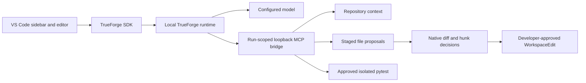

# ForgePilot AI

**Understand. Engineer. Verify.**

ForgePilot is a native VS Code extension for proposing and reviewing repository changes. TrueForge owns model calls, sessions, tool selection, and the agent loop. The extension assembles context, runs a local workspace MCP bridge, and applies reviewed changes through VS Code.

## Install and connect

Requires VS Code 1.105 or later, Node.js 22.14 or later, and ripgrep on PATH. Use [START_HERE.md](START_HERE.md) for the short installation and demonstration order.

```bash
npm ci
npm test
npm run package
code --install-extension submission/ForgePilot-AI.vsix
```

Start TrueForge in a terminal on the same machine as the extension host.

```bash
HOST=127.0.0.1 OUTBOUND_URL_ALLOWED_HOSTS='["127.0.0.1"]' npx --yes @truefoundry/trueforge@0.185.1 --port 8790
```

The allowlist authorizes the run-scoped MCP URL and a local model endpoint. Keep this instance on loopback. Configure a provider at `http://127.0.0.1:8790` in **Settings → Models → Configure**, then set **ForgePilot: Model** to the exact configured `provider/model` ID. Enter credentials in TrueForge. The extension needs only the model ID and local server URL. For a credential-free CPU setup, a tool-capable model served by llama.cpp works through TrueForge’s custom OpenAI-compatible provider. Select a more capable model for the multi-file demo if one is authorized.

### Reproduce the credential-free verification model

The verified model was Qwen2.5-3B-Instruct, Q4_K_M, served by llama.cpp. Download the [official model file](https://huggingface.co/Qwen/Qwen2.5-3B-Instruct-GGUF/resolve/7dabda4d13d513e3e842b20f0d435c732f172cbe/qwen2.5-3b-instruct-q4_k_m.gguf) and use a native [llama.cpp build](https://github.com/ggml-org/llama.cpp/releases). The downloaded model SHA-256 is `626b4a6678b86442240e33df819e00132d3ba7dddfe1cdc4fbb18e0a9615c62d`.

```bash
llama-server -m qwen2.5-3b-instruct-q4_k_m.gguf --alias qwen2.5-3b-instruct \
  --host 127.0.0.1 --port 18080 --jinja --ctx-size 12288 --parallel 1 --threads 2 --temp 0.1
node scripts/local-provider.cjs forgepilot-local 18080 qwen2.5-3b-instruct
```

Set **ForgePilot: Model** to `forgepilot-local/coding-model`. The CPU model can take several minutes, depending on the repository context and edit size. If TrueForge reports a body timeout before the CPU model emits its first token, start the optional loopback keepalive and re-register the same model at its port.

```bash
node scripts/local-model-keepalive.cjs 18080 18082
node scripts/local-provider.cjs forgepilot-local 18082 qwen2.5-3b-instruct
```

The transport relays model bytes and sends standard SSE keepalive comments during idle periods. TrueForge remains responsible for the model request, parsing, sessions and tool orchestration.

### Local model for the multi-file evaluation

ForgePilot also evaluated [Qwen3-4B Q4_K_M](https://huggingface.co/Qwen/Qwen3-4B-GGUF/tree/bc640142c66e1fdd12af0bd68f40445458f3869b). The verified model-file SHA-256 is `7485fe6f11af29433bc51cab58009521f205840f5b4ae3a32fa7f92e8534fdf5`.

```bash
llama-server -m Qwen3-4B-Q4_K_M.gguf --alias qwen3-4b \
  --host 127.0.0.1 --port 18091 --jinja --reasoning off --ctx-size 12288 --parallel 1 --threads 2
node scripts/local-model-keepalive.cjs 18091 18092
node scripts/local-provider.cjs forgepilot-qwen3 18092 qwen3-4b 2500 12288
```

Start the model server and keepalive in separate terminals. Set **ForgePilot: Model** to `forgepilot-qwen3/coding-model`.

For local development, run `npm run compile`, then press F5 using the **Run ForgePilot** launch configuration and open Flask in the Extension Development Host.

## Use ForgePilot

- **Inline edit** — Select code and invoke **ForgePilot: Inline Edit** from the Command Palette or editor context menu. Enter an instruction, then check the proposal in the native side-by-side diff.
- **Agent Mode** — Open ForgePilot in the Activity Bar, choose Agent Mode, and describe the change. Use `@file:src/flask/cli.py` or `@symbol:get_debug_flag` to pin context when needed. Expand ContextLens to inspect selected excerpts.
- **Review** — Approve or reject individual hunks. Preview accepted hunks and apply them, or accept all remaining hunks. Save changed editors before inspecting on-disk results. Undo restores the latest ForgePilot transaction if subsequent edits are absent.
- **Verify** — On a Linux host with working bubblewrap, system Python and pytest dependencies, the agent can request approval for explicit pytest targets under `tests/`. ForgePilot runs them against a temporary, network-isolated snapshot. If sandbox startup fails, use the participant-controlled terminal on a saved, reviewed demo checkout.

## Architecture



One user request maps to one TrueForge session. The extension consumes observable turn events, resumes a dropped stream once by event ID, and exposes Stop immediately while requesting cancellation from TrueForge. Every run gets a short-lived, randomly addressed MCP endpoint. The bridge uses bounded inputs and expires at run completion or cancellation. Review checks document versions and original contents. Failed and cancelled runs discard proposals. No built-in shell tool is attached to the TrueForge agent.

## Verification

- `npm test` compiles the extension and runs nine offline checks.
- `node scripts/smoke.cjs --discovery-only` checks the live TrueForge MCP discovery path.
- `FORGEPILOT_MODEL=provider/model npm run test:live` requires both an actual streamed response and a tool invocation.
- [Verification record](submission/VERIFICATION.md) records observed results. [Demo script](submission/DEMO_SCRIPT.md) covers all three Flask tasks.

## Limits

One trusted local workspace folder is selected per run. Undo history is kept for the extension host session. Runtime searches rely on ripgrep. Python verification requires bubblewrap and a system Python with the repository’s test dependencies available inside the sandbox. Hosted model providers receive the instruction and bounded selected workspace text via TrueForge. Use a local model for repositories whose contents must remain local.
